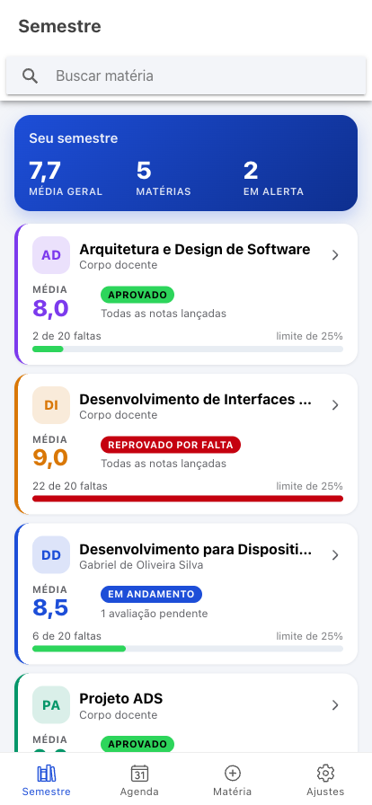
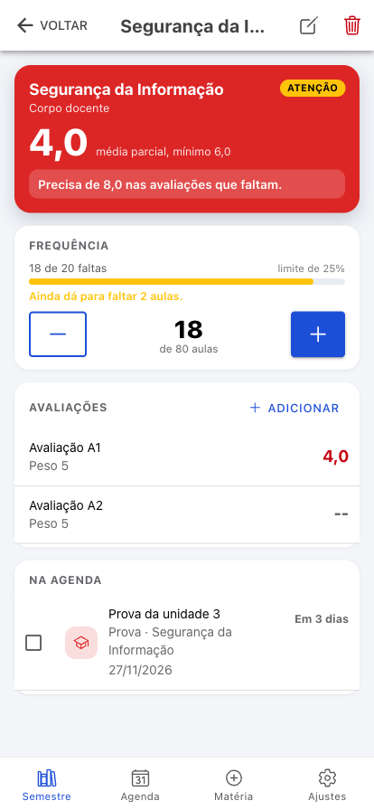
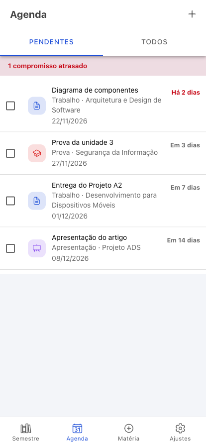
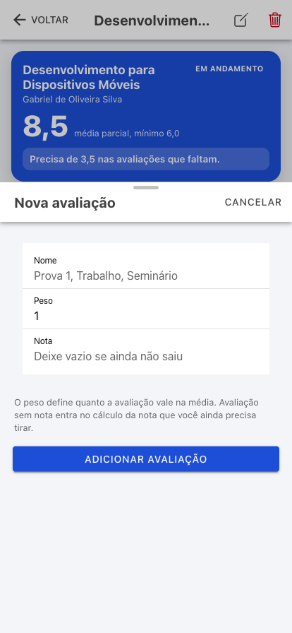
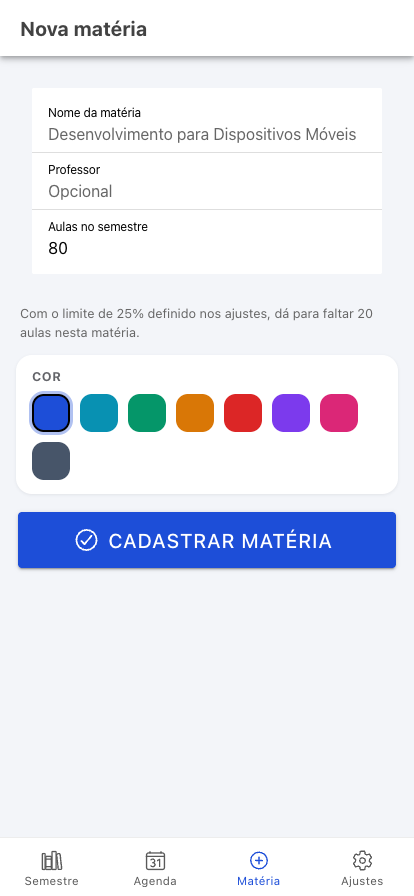
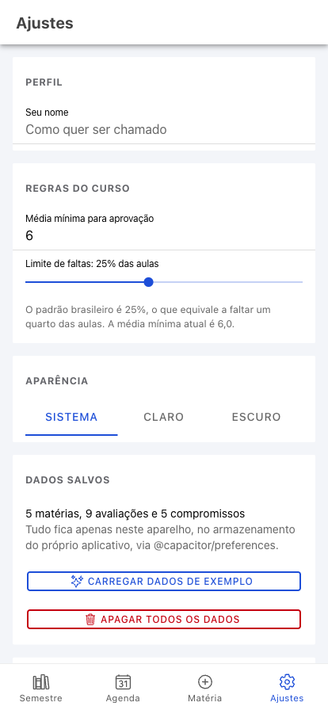
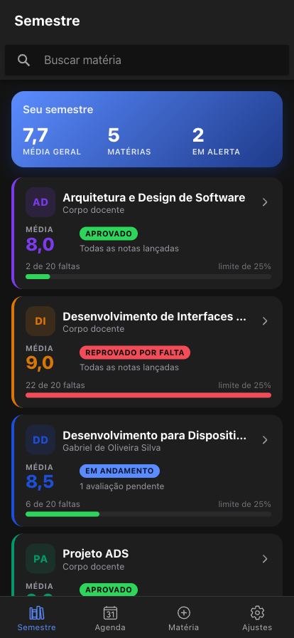

<div align="center">

# 🎓 Boletim — Acompanhamento Acadêmico

Aplicativo híbrido para o aluno acompanhar o próprio semestre: notas por avaliação com peso, controle de faltas com o limite da instituição, a nota que ainda precisa tirar para passar e a agenda de provas e trabalhos. Funciona sem internet, com os dados guardados no próprio aparelho.


</div>

---

## Telas do aplicativo

<div align="center">

| Semestre | Detalhe da matéria | Agenda |
|:---:|:---:|:---:|
|  |  |  |
| Média geral, matérias em alerta e o cartão de cada disciplina | Nota necessária, contador de faltas e avaliações | Prazos ordenados, com atraso em destaque |

| Nova avaliação | Nova matéria | Ajustes | Tema escuro |
|:---:|:---:|:---:|:---:|
|  |  |  |  |
| Modal de meia tela | Cor e carga horária | Regras do curso | A mesma tela no escuro |

</div>

> As telas acima usam o semestre de demonstração, que pode ser carregado em
> **Ajustes → Dados salvos → Carregar dados de exemplo**.

## Visão geral

Todo aluno faz a mesma conta de cabeça no meio do semestre: quanto preciso tirar
na última prova, e quantas aulas ainda posso perder. O Boletim transforma essas
duas contas em tela.

Cada matéria guarda as avaliações com o peso de cada uma, o total de aulas do
semestre e as faltas já usadas. A partir disso o app calcula a média ponderada
parcial, a nota necessária nas avaliações que faltam e o veredito da matéria,
que inclui a reprovação por falta mesmo quando a nota está boa.

Não há servidor, login ou sincronização. Os dados ficam no armazenamento nativo
do aparelho através do **@capacitor/preferences**, o que torna o aplicativo
utilizável offline e mantém o histórico escolar fora de qualquer nuvem.

A interface é **Ionic 9 com React 19**, com navegação por abas, tela de detalhe
empilhada e estado compartilhado por Context. Os cálculos acadêmicos ficam em
funções puras, separadas dos componentes, e por isso são testados sem renderizar
tela.

Projeto em grupo da disciplina **Desenvolvimento para Dispositivos Móveis**, no
Centro Universitário UniGoiás. Professor Gabriel de Oliveira Silva.

**Integrantes:** Matheus Trajano · Marcos Vinícius Moreira da Silva · Diego de Jesus Modesto Silva

## Funcionalidades

- **Cadastro de matérias** com professor, carga horária do semestre e cor própria
- **Avaliações com peso**, podendo ficar sem nota enquanto o resultado não sai
- **Média ponderada parcial**, calculada apenas sobre o que já foi lançado
- **Nota necessária** nas avaliações restantes para alcançar a média mínima
- **Veredito por matéria**: aprovado, em andamento, atenção, reprovado por nota ou reprovado por falta
- **Controle de faltas** com botões de somar e subtrair, limite calculado a partir da carga horária
- **Agenda de provas, trabalhos e apresentações**, com contagem regressiva e aviso de atraso
- **Painel do semestre** com média geral, total de matérias e quantas estão em alerta
- **Busca por matéria**, que aparece quando a lista passa de três
- **Regras configuráveis**: média mínima e percentual de falta permitido
- **Tema claro e escuro**, seguindo o sistema ou forçado pelo usuário
- **Apagar todos os dados** em uma ação única, com confirmação
- **Semestre de demonstração** carregável com um toque, para avaliar o app sem digitar nada

## Stack

| Camada | Tecnologia |
|---|---|
| Interface | Ionic 9 · React 19 · TypeScript 5 |
| Navegação | `react-router` 6 com `IonTabs` e `IonRouterOutlet` |
| Estado | Context API com `useState`, `useEffect`, `useMemo` e `useCallback` |
| Persistência | `@capacitor/preferences` 8, isolado em uma camada de serviço |
| Empacotamento nativo | Capacitor 8 (Android e iOS) |
| Build | Vite 8 com `@vitejs/plugin-legacy` |
| Testes | Vitest 5 · Testing Library · happy-dom |

## Documentação

O relatório técnico do projeto está em
[`docs/Projeto A2 - Boletim - Grupo - v1.0.docx`](./docs/), no formato de
relatório acadêmico, com dezesseis seções: identificação, visão geral,
objetivos, escopo, justificativa, riscos, custos, cronograma, equipe,
aprovações, controle de versões, atas, levantamento de requisitos com doze
casos de uso detalhados, projeto com modelo de dados e dicionário, algoritmos e
fluxograma, desenvolvimento com trechos de código comentados, e testes com os
trinta e quatro cenários unitários e os seis funcionais.

## Estrutura do repositório

```text
Boletim-Projeto-Mobile/
├─ docs/
│  ├─ Projeto A2 - Boletim - Grupo - v1.0.docx   # relatório técnico
│  └─ capturas/                 # capturas das telas usadas neste README
├─ public/            # ícone, favicon e manifesto do PWA
├─ scripts/           # gerador do ícone em PNG, sem dependência externa
└─ src/
   ├─ components/     # componentes reutilizáveis
   ├─ contextos/      # contexto e provedor do estado compartilhado
   ├─ dados/          # catálogo de cores e tipos, mais o semestre de exemplo
   ├─ hooks/          # useBoletim e useTema
   ├─ pages/          # as cinco telas
   ├─ servicos/       # única porta de entrada do @capacitor/preferences
   ├─ theme/          # identidade visual
   └─ utils/          # cálculo e formatação, com os testes ao lado
```

## Como rodar (desenvolvimento)

### Pré-requisitos

| Requisito | Versão mínima | Verificar com |
|---|---|---|
| Node.js | 20.19 | `node -v` |
| npm | 11 | `npm -v` |

> O npm 10 que acompanha o Node 20 falha neste projeto com
> `Cannot read properties of null (reading 'edgesOut')`, um defeito conhecido do
> resolvedor de dependências daquela versão. Se for o seu caso, instale com
> `npx npm@11 install` sem precisar trocar o Node.

### 1. Clonar o projeto

```bash
git clone https://github.com/MathTrajan/Boletim-Projeto-Mobile.git
cd Boletim-Projeto-Mobile
```

### 2. Instalar as dependências

```bash
npm install
```

### 3. Subir a aplicação

```bash
npm run dev
```

A interface abre em `http://localhost:5173`. Para ver no formato de celular,
abra as ferramentas do navegador e ative a emulação de dispositivo.

### 4. Outros comandos

```bash
npm run build     # gera a pasta dist/
npm run preview   # serve a pasta dist/ para conferência
npm test          # 34 testes de regra acadêmica e formatação
npx tsc --noEmit  # verificação de tipos
```

## Gerando o aplicativo Android

O `capacitor.config.ts` já está configurado com o identificador
`br.edu.boletim.mobile` e a pasta `dist` como origem, e o `@capacitor/android`
já está nas dependências.

```bash
npm run build
npx cap add android     # exige Node 22 ou mais novo
npx cap sync
npx cap open android    # abre o Android Studio para gerar o APK
```

Para compilar o APK pela linha de comando são necessários, além do projeto:

| Requisito | Observação |
|---|---|
| JDK 17 ou 21 | O Gradle do Capacitor 8 ainda não aceita JDK 25 ou 26. Erro típico: `Unsupported class file major version` |
| Android SDK | Instalado pelo SDK Manager do Android Studio, ou por `brew install --cask android-commandlinetools` |
| Node 22 ou mais novo | A CLI do Capacitor recusa o Node 20. O restante do projeto roda em Node 20 |

Com os três presentes:

```bash
cd android && ./gradlew assembleDebug
# saída em android/app/build/outputs/apk/debug/app-debug.apk
```

As pastas `android/` e `ios/` não são versionadas: são centenas de arquivos
gerados, que os comandos acima recriam em qualquer máquina.

## Telas

| Rota | Tela | Conteúdo |
|---|---|---|
| `/semestre` | Semestre | Painel com média geral e alertas, mais o cartão de cada matéria com média, situação e faltas |
| `/semestre/:id` | Detalhe da matéria | Média, nota necessária, contador de faltas, lista de avaliações e os compromissos da matéria |
| `/agenda` | Agenda | Provas, trabalhos e apresentações por data, com contagem regressiva e marcação de concluído |
| `/materia` e `/materia/:id` | Formulário | Cadastro de matéria. Com `:id` na rota, a mesma tela funciona como edição |
| `/ajustes` | Ajustes | Nome, média mínima, limite de faltas, tema, apagar dados e informações do trabalho |

A navegação por abas cobre Semestre, Agenda, Matéria e Ajustes. O detalhe da
matéria é empilhado sobre a aba Semestre, com botão de voltar, porque pertence
ao contexto dela.

## Componentes

| Componente | Responsabilidade |
|---|---|
| `CartaoMateria` | Cartão da matéria na lista do semestre, com sigla, média, situação e faltas |
| `BarraFaltas` | Barra de frequência que muda de cor conforme o limite se aproxima. Tem uma versão compacta para o cartão |
| `EtiquetaSituacao` | Selo colorido do veredito da matéria |
| `ItemAvaliacao` | Linha da avaliação, com arraste para editar e excluir |
| `ItemCompromisso` | Linha da agenda, com caixa de marcação, prazo e arraste para excluir |
| `ModalAvaliacao` | Formulário de avaliação em modal, usado tanto para criar quanto para editar |
| `EstadoVazio` | Bloco de "nada aqui ainda", reaproveitado em quatro situações |
| `AlertaConfirmacao` | Confirmação antes de apagar, usada em quatro pontos diferentes |

## Regras de cálculo

| Regra | Como é calculada |
|---|---|
| Média parcial | Média ponderada apenas das avaliações que já têm nota |
| Nota necessária | `(média mínima × peso total − pontos já obtidos) ÷ peso pendente` |
| Limite de faltas | Parte inteira de `aulas do semestre × percentual permitido` |
| Reprovado por falta | Faltas **acima** do limite. Faltar exatamente o limite ainda aprova |
| Atenção | Precisa de 7,0 ou mais nas avaliações restantes |
| Reprovado por nota | Nota necessária acima de 10, ou média final abaixo da mínima |

## Persistência

Todo acesso ao plugin passa por [`src/servicos/armazenamento.ts`](./src/servicos/armazenamento.ts),
com três chaves:

| Chave | Conteúdo |
|---|---|
| `boletim.materias` | Matérias com as avaliações aninhadas |
| `boletim.compromissos` | Agenda de provas e trabalhos |
| `boletim.configuracao` | Nome, média mínima, limite de faltas e preferência de tema |

A leitura valida campo a campo e descarta registro corrompido em vez de deixar a
tela quebrar. A gravação só é liberada depois que a leitura inicial termina, para
o primeiro render não salvar a lista vazia em cima do que já estava gravado.

## Identidade visual

| Elemento | Definição |
|---|---|
| Nome | Boletim |
| Cor da marca | Azul `#1D4ED8`, com `#0E2F8F` no gradiente do painel |
| Destaque | Dourado `#D97706`, usado no cordão do birrete |
| Ícone | Birrete, em `public/icone.png` (512×512) e `public/favicon.png` (64×64) |
| Cor por matéria | Oito cores à escolha no cadastro, usadas no cartão e na capa do detalhe |
| Tema | Claro e escuro, com a paleta do Ionic aplicada por classe no `<html>` |

O ícone é gerado por [`scripts/gerar-icones.py`](./scripts/gerar-icones.py), que
desenha o PNG por função de distância usando apenas a biblioteca padrão do
Python, sem editor de imagem no caminho.

## Testes

```bash
npm test
```

34 testes cobrindo o que quebra em silêncio: média ponderada com avaliação
pendente, nota necessária sobre o peso total, a fronteira entre faltar o limite e
estourar o limite, reprovação por falta com nota alta, contagem de dias
atravessando a virada de mês e ordenação que respeita acento.

> Se um teste falhar rodando em Node 20, o relatório de erro do Vitest quebra com
> `Map.groupBy is not a function`, porque esse método só existe a partir do
> Node 21. Os testes em si rodam normalmente. Para ler a mensagem de falha, use
> Node 22 ou mais novo.

## Decisões de implementação

As escolhas que não se explicam sozinhas lendo o código, e o motivo de cada uma:

| Decisão | Motivo |
|---|---|
| Datas circulam como texto `AAAA-MM-DD` | `new Date('2026-12-01')` é lido em UTC e exibiria 30/11 no horário de Brasília |
| Nota pendente é `null`, não zero | Zero entraria na média e mostraria o aluno reprovado antes de a prova acontecer |
| Nota necessária sobre o peso total, não sobre o pendente | A conta precisa considerar o que já foi feito, senão a meta sai errada em matéria com pesos diferentes |
| Reprovação por falta checada antes da nota | Nenhuma média salva quem perdeu a frequência, então esse veredito vem primeiro |
| Avaliações aninhadas na matéria | Não existe avaliação sem matéria, e assim apagar a matéria não deixa registro órfão |
| Cálculos em funções puras, fora dos componentes | Permite testar regra acadêmica sem renderizar tela |
| Estado em Context, não em cada tela | Sem isso, cada tela leria o armazenamento por conta própria e mostraria um retrato diferente dos mesmos dados |
| Campos numéricos guardados como texto | Reformatar o número a cada tecla trocaria a vírgula por ponto no meio da digitação |
| Barras de progresso em CSS, sem biblioteca | Uma biblioteca de gráfico somaria centenas de kB ao pacote para desenhar retângulos |
| `happy-dom` no lugar do `jsdom` do starter | O `jsdom` puxa o `undici`, que exige Node 22. Com ele, os testes não iniciavam no Node 20 |
| Paleta escura por classe, não por `prefers-color-scheme` | A tela de Ajustes permite forçar claro ou escuro, e não só seguir o sistema |
